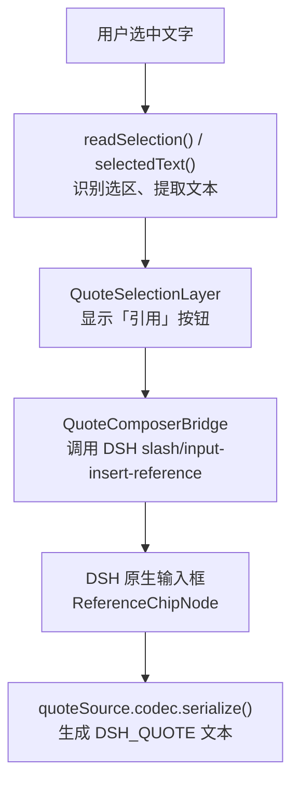

# Inline Quote (`dsh-inline-quote`)

A small DeepSeek Harness (DSH) Web Client plugin. Select text in a chat message, click **引用 / Quote**, and insert a native reference chip into the existing composer. Text and multiple quote chips can be interleaved.


**Status:** v0.1.x supports *chat-row* quotations in DSH `0.2.1-rc.3` (prior isolated Client/Host-mock testing). **Quoting Trajectory text is not yet verified.** The `main` package currently declares `0.1.0`; the subsequent `0.1.1` npm update was for documentation/screenshots, not a new feature.

## 项目开发入口 / What actually runs

**核心逻辑只有一个文件：[`client.js`](client.js)。** [`index.js`](index.js) 只是空的 Host `apply()` 入口；[`cordis.patch.yml`](cordis.patch.yml) 和 [`package.json`](package.json) 负责安装和注册。这里没有 `CoreService` 或 `ctx.command('quote')` 后端调用链。



| 看什么 | 源码位置 | 实际用途 |
| --- | --- | --- |
| 划词内容提取 | [`client.js` L99–123](client.js#L99-L123) | `range.cloneContents()`、`innerText`；存在链接文字丢失风险 |
| 是否允许引用 | [`client.js` L129–160](client.js#L129-L160) | `readSelection()`：**目前 v0.2 开发只改这一段** |
| 弹出引用按钮 | [`client.js` L384–458](client.js#L384-L458) | `QuoteSelectionLayer` |
| 插入输入框 | [`client.js` L686–795](client.js#L686-L795) | `QuoteComposerBridge`；使用现有 DSH Chip |
| 发送时序列化 | [`client.js` L258–306](client.js#L258-L306) | `quoteSource.codec.serialize()` 生成 `⟦DSH_QUOTE …⟧` |

> 上述行号对应 **`main`（v0.1.x）**。改动中的函数可直接从 [Draft PR #5 的 `client.js` diff](https://github.com/anqifox/dsh-inline-quote/pull/5/files) 查看；不要误把未合并分支当成已发布功能。

### 当前唯一研发主线

**目标：** DSH 的「轨迹」中划选可见文字 → 点击「引用」 → 正确插入当前会话的 Chip。

- **进行中：** [Issue #2 — 真实轨迹最小验证](https://github.com/anqifox/dsh-inline-quote/issues/2) / [Draft PR #5 — 仅修改 `client.js`](https://github.com/anqifox/dsh-inline-quote/pull/5)。
- **已知真实缺陷：** [Issue #3 — 文件链接文字丢失](https://github.com/anqifox/dsh-inline-quote/issues/3)。
- **未完成：** 新代码尚无真实轨迹与 Host 发送验收。不要用「提交成功」「语法检查通过」代替功能通过。
- **先做的人工验证：** 在独立 DSH 实例中选一段真实轨迹文字，点击「引用」，核对 Chip 内容；成功后才测跨记录。失败先修实际阻断点。
- **保持不变：** `DSH_QUOTE` 模型传递格式、已有 Chip、正常输入和草稿机制。**不发布、不合并**未验证的 v0.2。

## 安装与基本使用 / Install

```powershell
dsh plugin --profile <profile> add dsh-inline-quote
```

使用时在 DSH 聊天正文划选文字，点「引用」；点击输入框中的 Chip 可查看原文或删除引用。插件走 Web Client，不修改 `app.asar`。要在隔离配置中试验本地版本：

```powershell
$env:DSH_HOME = 'C:\path\to\isolated\dsh-home'
dsh plugin --profile quote-probe add 'C:\path\to\dsh-inline-quote'
```

**卸载提醒：** 已保存但尚未发送的 `quote` Chip 依赖此插件的引用来源。卸载前先发送或清空这些草稿，避免恢复失败。

## 工程负担：哪些真正服务于当前功能？

截至 2026-10-30，`main` 有 **59 个文件**，其中 **44 个属于 `tests/`**（包括 33 个 `.mjs` 脚本）。`client.js` 约 **937 行**，但 `index.js` 只是空入口。文件数量不等于软件质量。

| 内容 | 当前处理原则 |
| --- | --- |
| `client.js`、`index.js`、`package.json`、`cordis.patch.yml` | 插件运行相关；优先看真实调用链，不按文件数猜复杂度 |
| `tests/e2e/`、`tests/probe-plugin/`、`tests/host-mock/` | **历史测试设施**，保留证据，但不作为每次改动必须扩建的模板 |
| `TEST-RESULTS.md`、`PUBLISH.md`、`CHANGELOG.md` | 历史验证/发布资料；不代表 v0.2 已通过 |
| `screenshots/`、`locale/`、`LICENSE` | 演示、语言与发布授权资料；本身不是运行复杂度问题 |

**需要审视的投入偏差：** 既有工程花了大量精力验证超长引用、容量回滚、竞态和跨会话场景；这些并非全都无价值，但当前最基本的**轨迹划词引用**尚未验证，不应继续先扩张测试平台、文档和发布流程。历史报告称 21 项回归中 20 PASS / 1 UNVERIFIED，**本轮未重新执行**；不要把历史报告当当前测试结果。

- [原有测试与运行前提](tests/README.md) · [历史测试结果](TEST-RESULTS.md) · [版本变更](CHANGELOG.md)
- [本 README 精简前的详细说明（Git 历史）](https://github.com/anqifox/dsh-inline-quote/blob/0201908c96ea9f32104858c27e8f40de961229aa/README.md)

**维护原则：先把功能实际跑通，再针对真实问题测试；GitHub 保存代码和证据，不用新文件数量冒充开发进度。**
