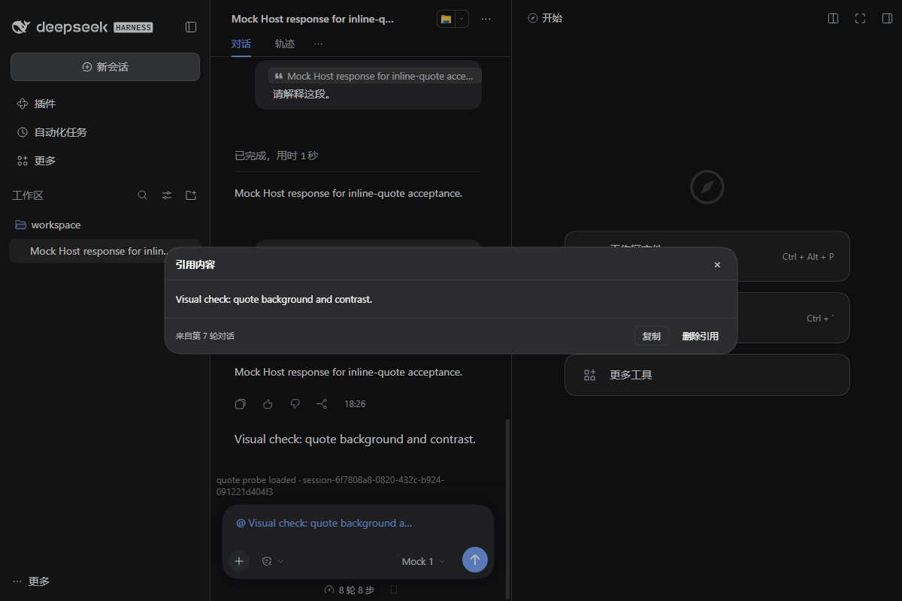

# Inline Quote for DeepSeek Harness

**Select text. Click Quote. Keep the excerpt in your message.**

为 DeepSeek Harness (DSH) 提供行内引用：在聊天中划选文字，点击 **引用**，即可将原文插入输入框，显示为可交互的引用标签（Chip），并与自己的文字混排。

A small Web Client plugin for [DeepSeek Harness](https://github.com/deepseek-ai/deepseek-harness). Select text in a chat message, click **Quote**, and insert a native reference chip into the existing composer.



[Light mode preview](screenshots/quote-preview-light.png)

## Features / 功能

- **Inline quotes / 行内引用：** Insert one or multiple excerpts alongside normal text, in any order.
- **Native chips / 原生标签：** Use DSH's existing composer instead of a separate chat or quote panel.
- **Preview / 原文预览：** Click a chip to read or copy the complete excerpt. Code excerpts retain indentation and line breaks.
- **Edit / 编辑：** Remove a quote from the draft or undo the deletion. Previously sent quotes remain read-only.
- **Model context / 模型上下文：** The full quoted text is passed with explicit `DSH_QUOTE` boundaries, not just the short chip label.

## Install / 安装

```powershell
dsh plugin --profile <profile> add dsh-inline-quote
```

Replace `<profile>` with your DSH profile name. Restart or reload the relevant DSH client if your installation requires it.

## How to use / 使用方法

1. Open a conversation in DSH and select text in a completed message. / 在已完成的聊天消息中划选文字。
2. Click **引用 / Quote** beside the selection. / 点击浮现的「引用」。
3. Continue typing around the inserted chip; click it to preview or remove it. / 在引用标签前后继续输入，点击标签查看原文。

## Compatibility & limitations / 兼容性与限制

- Developed and tested against **DSH `0.2.1-rc.3` Web Client**. Other DSH versions have not been verified.
- The current release accepts selections **within one completed chat row**. Selection across multiple messages and quoting from the **Trajectory / 轨迹** view are not available in the released version.
- The plugin uses some internal DSH Client interfaces. An upstream change may require a compatibility update.
- Drafts containing quote chips depend on this plugin. **Send or clear those drafts before uninstalling it.**

## Development / 开发

For maintainers and AI contributors: **[Code map — architecture, call flow and fixed source links](docs/CODE-MAP.md)**.

Source: [`client.js`](client.js) · [Changes](CHANGELOG.md) · [Issues](https://github.com/anqifox/dsh-inline-quote/issues) · [Pull requests](https://github.com/anqifox/dsh-inline-quote/pulls).

The next feature being explored is selecting and quoting text from the Trajectory view. See [the prototype PR](https://github.com/anqifox/dsh-inline-quote/pull/5); it is **not part of the released version**.

MIT License — see [LICENSE](LICENSE).
