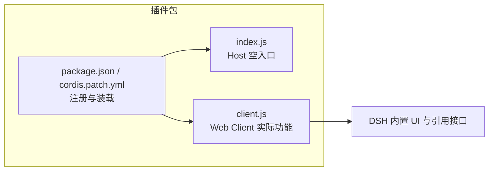
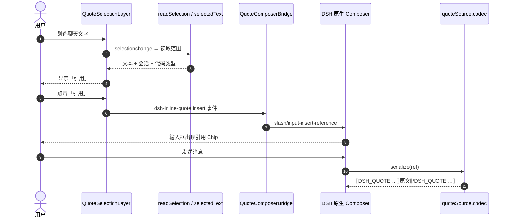

# 开发导航｜实际代码结构与调用链

> **对象：维护者和接手项目的 AI。** 这不是插件介绍、需求清单或进度台账。需要向用户介绍插件，请回到 [README](../README.md)；需要处理 v0.2，直接看 [Issue #2](../issues/2) 和 [PR #5](../pull/5)。
>
> **源码基线：** 已发布功能的 `main` 版本 [`0206661`](https://github.com/anqifox/dsh-inline-quote/tree/0206661636158edf6ce49f1f61159f558bf4afff)。下方**固定行号链接**指向此提交，而不是随时移动的 `main`；v0.2 原型见 [`6cf14ff`](https://github.com/anqifox/dsh-inline-quote/tree/6cf14ff2ae1e2b9a580ae6382820ba2aedb4740b) 与 [diff](../pull/5/files)。

## 1. 骨架：先识别真正的入口



- [`index.js`](../index.js) 的 `apply()` 是空函数，**没有** `ctx.command('quote')` 或所谓 `CoreService`。
- [`client.js`](../client.js) 注册引用源、选区层、预览层、输入框桥接和已发送消息显示；`package.json` / `cordis.patch.yml` 仅负责插件入口与依赖装载。
- 这是以**单个前端脚本**为核心的插件；包依赖图不能代替脚本内部事件调用链。不要为了画一个“依赖树”安装 Madge / dependency-cruiser。

## 2. 实际链路：从用户行为追到模型收到的内容



**另外两条独立的显示路径：** 点击编辑中的 Chip → `quoteSource.openReference` → `QuotePreviewLayer`；已发送的引用标记 → `matchQuoteMarker` → `InlineQuotedUserText`。它们不是另一套后端服务。

## 3. 关键函数地图（固定代码锚点）

| 阅读顺序 | 实际函数 / 机制 | 用途 / 首先排查什么 |
| --- | --- | --- |
| 1 | [`readSelection()`](https://github.com/anqifox/dsh-inline-quote/blob/0206661636158edf6ce49f1f61159f558bf4afff/client.js#L129-L171) | 选区能否获得引用按钮；当前正式版只允许同一聊天行 |
| 2 | [`selectedText()`](https://github.com/anqifox/dsh-inline-quote/blob/0206661636158edf6ce49f1f61159f558bf4afff/client.js#L99-L117) | 选区文字保真；文件链接文字丢失应先查这里 |
| 3 | [`QuoteSelectionLayer`](https://github.com/anqifox/dsh-inline-quote/blob/0206661636158edf6ce49f1f61159f558bf4afff/client.js#L384-L476) | 显示按钮，将选中文本发到 `dsh-inline-quote:insert` |
| 4 | [`QuoteComposerBridge.insert()`](https://github.com/anqifox/dsh-inline-quote/blob/0206661636158edf6ce49f1f61159f558bf4afff/client.js#L746-L820) | 将数据交给 DSH 原生 `slash/input-insert-reference` |
| 5 | [`quoteSource.codec.serialize()`](https://github.com/anqifox/dsh-inline-quote/blob/0206661636158edf6ce49f1f61159f558bf4afff/client.js#L258-L288) | 发送时将 Chip 展开成模型可读的原文 |
| 6 | [`quoteSource.openReference()`](https://github.com/anqifox/dsh-inline-quote/blob/0206661636158edf6ce49f1f61159f558bf4afff/client.js#L258-L266) + [`QuotePreviewLayer`](https://github.com/anqifox/dsh-inline-quote/blob/0206661636158edf6ce49f1f61159f558bf4afff/client.js#L477-L631) | 用户点击标签查看原文 |
| 7 | [`matchQuoteMarker()`](https://github.com/anqifox/dsh-inline-quote/blob/0206661636158edf6ce49f1f61159f558bf4afff/client.js#L290-L320) + [`InlineQuotedUserText`](https://github.com/anqifox/dsh-inline-quote/blob/0206661636158edf6ce49f1f61159f558bf4afff/client.js#L322-L369) | 已发送消息中的引用标签 |
| 8 | [`apply(ctx)` 注册区](https://github.com/anqifox/dsh-inline-quote/blob/0206661636158edf6ce49f1f61159f558bf4afff/client.js#L886-L934) | 上述组件接入 DSH 的位置 |

**正在修改的真实位置：** [v0.2 分支的 `readSelection()`](https://github.com/anqifox/dsh-inline-quote/blob/6cf14ff2ae1e2b9a580ae6382820ba2aedb4740b/client.js#L129-L188) 扩大了轨迹区域的选区准入；尚未在真实 DSH 轨迹中验收，不能写成已完成功能。

## 4. 看一段核心实现，不用把 900 多行重读一遍

源代码 [`QuoteComposerBridge.insert()` 的核心调用](https://github.com/anqifox/dsh-inline-quote/blob/0206661636158edf6ce49f1f61159f558bf4afff/client.js#L763-L774)：

```js
const reference = {
  source: 'quote',
  ref: encodeRef(payload),
  label: payload.label,
  clipboardText: tokenFor(payload.id),
}
if (reference.ref.length > MAX_REF_LENGTH) {
  dispatchError(tr(translateRef.current, 'error.tooLarge', '引用过长，无法安全保存草稿。请缩短后重试。'))
  return
}
const applied = actx.bail(actx, 'slash/input-insert-reference', { reference, span })
```

**解释：** 这里是将引用插入 DSH 的既有输入框；不是调用 AI，也不是通过 `index.js`。引用发出时才由 `codec.serialize` 转成 `DSH_QUOTE` 文本。

## 5. 怎么用这张图定位问题

- **根本看不到「引用」：** 从 `readSelection` → `QuoteSelectionLayer` 追踪。真实轨迹原型：[PR #5](../pull/5)；目标：[Issue #2](../issues/2)。
- **按钮有了，但插不进 Chip：** 沿事件 `dsh-inline-quote:insert` → `QuoteComposerBridge.insert` → DSH 接口追踪；先观察浏览器实际事件和返回值，不先造更多测试框架。
- **Chip 有了但文字缺失：** 回到 `selectedText` 的 DOM 提取；已记录的链接文字问题：[Issue #3](../issues/3)。如果输入正确、发送错误，再看 `quoteSource.codec.serialize`。

**证据规则：** 上述链接和图说明的是当前源码结构；不等于真实运行验证。直接在 GitHub 页面查看固定源码、提交 diff 和 Issue 的实验结果。仅在**调用链真的改变**时维护本图；任务状态留在 Issue/PR，不在这里重复抄一份。
