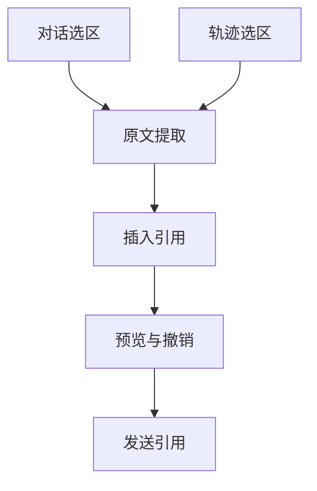

# DSH 内联引用 · 逻辑地图

这是当前仓库的功能逻辑快照，**不是测试通过证明**。节点随着证据更新，历史通过 Git 保留。

## 节点状态

| 节点 | 状态 | 已掌握 | 未知 | 下一步 |
|---|---|---|---|---|
| 对话选区 | 已发布 | README 确认 0.1.0 支持单条消息选区。 | 本轮未重新进行真实 DSH 测试。 | 仅在版本兼容问题出现时核查。 |
| 轨迹选区 | 已编码，待验证 | PR #5 尚处于开放草案，未合并发布。 | 真实轨迹选区是否正确触发引用并保持原文。 | 在真实 DSH 轨迹执行一次引用闭环。 |
| 原文提取 | 已实现，有已知缺陷 | Issue #3 记录了按钮形式正文链接文字丢失的问题。 | 表格、列表、复杂链接中的更多保真边界。 | 修复正文按钮文字遗漏后验收真实引用。 |
| 插入引用 | 已有实现，部分未验证 | 历史测试覆盖会话路由、持久化和失败回滚。 | 两个真实输入桥同时挂载时的路由。 | 出现双输入框场景时补验收。 |
| 预览与撤销 | 已发布 | README 与测试记录存在相应功能证据。 | 本轮没有重新进行交互回归。 | 功能修改时验证预览与删除。 |
| 发送引用 | Host 模拟验证 | 2026-10-25 Host 模拟测试记录了完整引用请求。 | 本轮未在正式生产模型端验证。 | 发送协议变更后检查 Host 侧内容。 |

## 节点属性与原始证据

### 对话选区
- 职责：在已完成的聊天消息中选取文字。
- 来源：https://github.com/anqifox/dsh-inline-quote/blob/main/README.md

### 轨迹选区
- 职责：把轨迹视图的文字接入引用链路。
- 来源：https://github.com/anqifox/dsh-inline-quote/pull/5
- 变化：v0.2 已提交轨迹选区试验代码，尚未验收。

### 原文提取
- 职责：提取所选内容并保留可见文本和格式。
- 来源：https://github.com/anqifox/dsh-inline-quote/issues/3
- 变化：发现并记录部分链接正文丢失。

### 插入引用
- 职责：将引用插入当前会话输入框。
- 来源：https://github.com/anqifox/dsh-inline-quote/blob/main/TEST-RESULTS.md

### 预览与撤销
- 职责：预览原文、删除草稿引用并可撤销。
- 来源：https://github.com/anqifox/dsh-inline-quote/blob/main/README.md

### 发送引用
- 职责：将引用标签展开为带 DSH_QUOTE 边界的完整原文。
- 来源：https://github.com/anqifox/dsh-inline-quote/blob/main/TEST-RESULTS.md
